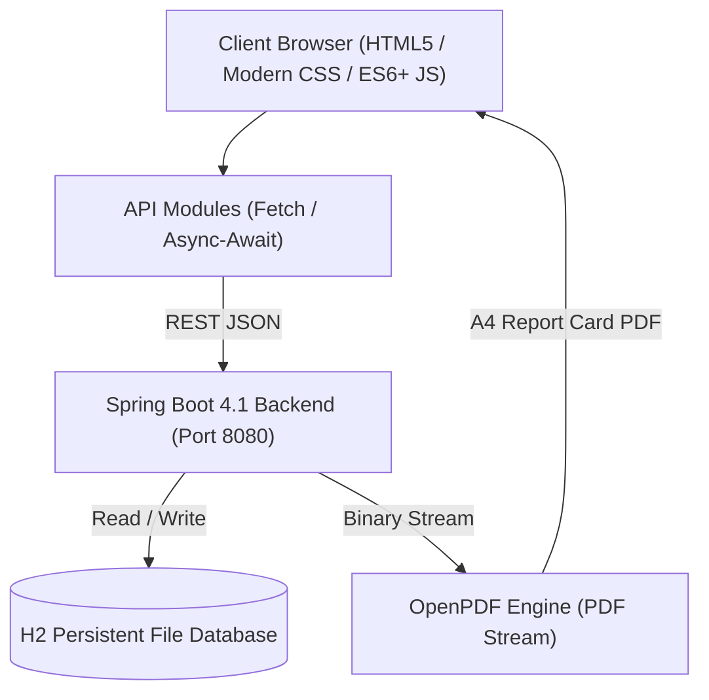

# 🏫 School Management System

A modern, full-stack School Management System built with a **Spring Boot 4 (Java 21)** REST API backend and a responsive, high-performance **Vanilla JavaScript & CSS (Glassmorphism)** frontend.


---

## 🌟 Key Features

### 1. 🎓 Student Management & Profiling
- **Registration & Validation**: Real-time accessible field validation (blur-triggered) with visual confirmations.
- **Student Directory**: Instant search by name, ID, or enrollment status, with class stream filtering.
- **Detailed Student Profiles**: Modals displaying academic standing, guardian contact details, attendance records, and immediate report card downloads.
- **Top Achievers Showcase**: Automatic calculation and visual recognition of top-performing students.

### 2. 👨‍🏫 Faculty & Allocation Subsystem
- **Teacher Directory & Hiring**: Form validation with specialized subject and class assignments.
- **Multi-Class Allocation**: Teachers can be assigned to multiple class streams (e.g., Form 1A, Form 2B) and primary subjects.
- **Bidirectional Visibility**: Class details show assigned faculty; teacher profile modals show assigned classes.

### 3. 📚 Classes & Curriculum Management
- **Class Stream Management**: Setup and tracking of academic class streams (Form 1A, Form 1B, Form 2A, etc.).
- **Curriculum & Subjects**: Manage core and elective subjects (e.g., Mathematics, Integrated Science, ICT) categorized by department and grade level.

### 4. 📅 Academic Calendar & Terms
- **Interactive Calendar Grid**: Visual monthly view of school events, exams, holidays, and milestones.
- **Term Progress Tracker**: Live progress bar computing current academic term timeline (e.g., Term 1, Term 2, Term 3).
- **Event Filter Sidebar**: Filter events by category (Exams, Holidays, Sports, General).

### 5. 📊 Attendance Tracker & Analytics
- **Daily Attendance Roster**: Quick bulk or individual status toggling (Present, Absent, Late, Excused).
- **Monthly Matrix View**: Calendar overview of class-wide attendance trends.
- **Attendance Analytics**: Percentage calculation and visual metrics for student retention.

### 6. 📝 Student Results & Official A4 PDF Report Cards
- **Score Entry Engine**: Records Continuous Assessment (CA 30%) + Exam (70%) with live weighted total computation.
- **Printable A4 PDF Report Cards**: Generated on-the-fly via the Spring Boot OpenPDF engine, featuring school branding, student bio grid, performance breakdown, class teacher remarks, and principal endorsement fields.

---

## 🏗️ Architecture & Tech Stack



### Backend
- **Framework**: Spring Boot 4.1.0 (Java 21)
- **Data Access**: Spring Data JPA / Hibernate
- **Database**: H2 Persistent File Database (`./data/school_management`) with built-in H2 Web Console
- **PDF Generation**: OpenPDF (`com.github.librepdf:openpdf:1.3.40`)
- **Testing**: JUnit 5, Spring Boot Test, MockMvc

### Frontend
- **Languages**: Semantic HTML5, Vanilla ES6+ JavaScript modules
- **Design System**: Glassmorphism aesthetic, custom CSS custom properties (tokens), responsive grid/flexbox
- **Security**: Strict XSS prevention utilizing safe DOM creation (`createElement`, `textContent`)
- **Testing**: Playwright End-to-End test suite

---

## 📂 Project Structure

```text
School_Mangement/
├── backend/                              # Spring Boot REST API
│   ├── src/main/java/com/miessan/schoolmanagement/
│   │   ├── config/                       # CORS & DataInitializer seeds
│   │   ├── controller/                   # REST API Controllers
│   │   ├── dto/                          # Data Transfer Objects & validation
│   │   ├── model/                        # JPA Entities (Student, Teacher, Class, etc.)
│   │   ├── repository/                   # Spring Data JPA Repositories
│   │   └── service/                      # Business logic & PDF generation
│   ├── src/main/resources/
│   │   └── application.properties       # App & H2 database configuration
│   ├── src/test/java/                    # Controller & Service unit tests
│   ├── pom.xml                           # Maven dependencies & build setup
│   └── mvnw                              # Maven wrapper executable
│
├── frontEnd/                             # Client-side web application
│   ├── index.html                        # Single Page / Tabbed dashboard layout
│   ├── style.css                         # Design system & Glassmorphic styling
│   └── js/
│       ├── api/                          # Modular fetch API services
│       ├── modules/                      # Feature modules (students, results, etc.)
│       └── utils/                        # Helper utilities (icons, dates)
│
├── tests/                                # Playwright automated E2E test specs
├── scripts/                              # Performance audit & browser scripts
├── AGENTS.md                             # Project development rules & design guidelines
├── HANDOVER.md                           # Recent milestones & audit documentation
└── package.json                          # Node dependencies for Playwright testing
```

---

## 🚀 Getting Started

### Prerequisites
Make sure you have the following installed:
- **Java 21 SDK** (or newer)
- **Node.js** (v18+ recommended) & `npm`
- Any modern web browser (Chrome, Edge, Firefox, Safari)

---

### Step 1: Start the Backend (Spring Boot)

1. Open your terminal and navigate to the `backend` directory:
   ```bash
   cd backend
   ```
2. Run the application using the Maven wrapper:
   - **macOS / Linux**:
     ```bash
     ./mvnw spring-boot:run
     ```
   - **Windows**:
     ```cmd
     mvnw.cmd spring-boot:run
     ```
3. The backend will start on **`http://localhost:8080`**.
   - **H2 Database Console**: Accessible at `http://localhost:8080/h2-console`
     - **JDBC URL**: `jdbc:h2:file:./data/school_management`
     - **User Name**: `sa`
     - **Password**: *(leave blank)*

> **Note**: On the first launch, [`DataInitializer.java`](backend/src/main/java/com/miessan/schoolmanagement/config/DataInitializer.java) automatically populates sample classes, subjects, teachers, students, academic terms, and results.

---

### Step 2: Launch the Frontend

The frontend uses standard ES6 modules, which require an HTTP server (to prevent browser CORS/file-protocol restrictions).

You can serve it with any static server:

#### Option A: Using VS Code Live Server
- Install the **Live Server** extension in VS Code.
- Right-click `frontEnd/index.html` and select **"Open with Live Server"** (default: `http://localhost:5500` or `http://localhost:5501`).

#### Option B: Using Node `npx serve`
From the project root directory:
```bash
npx serve -l 5500 frontEnd
```

#### Option C: Using Python
From the `frontEnd` directory:
```bash
cd frontEnd
python3 -m http.server 5500
```

Open your browser at **`http://localhost:5500`** (or the port specified by your server).

---

## 🧪 Running Tests

### 1. Backend Tests (Spring Boot + MockMvc)
Runs all unit and integration tests for controllers, services, and PDF streaming:
```bash
cd backend
./mvnw test
```

### 2. Frontend End-to-End Tests (Playwright)
Ensure the backend is running at `http://localhost:8080` and frontend at `http://localhost:5500`, then run:
```bash
# Install test dependencies (first time only)
npm install

# Run all Playwright tests
npm test

# Run tests with UI Test Runner
npm run test:ui

# Run tests in headed browser mode
npm run test:headed
```

---

## 🔒 Security & Code Standards

- **XSS Defense**: No direct interpolation of untrusted API strings into `.innerHTML`. All dynamic content renders via `textContent` or `document.createElement()`.
- **Form Validation**: Immediate accessible feedback on field blur (`aria-invalid`, actionable error descriptions, visual confirmation checks).
- **Design Consistency**: All styling respects the core CSS custom variables defined in `frontEnd/style.css`.

---

## 📄 License
This project is open-source and available under the [MIT License](LICENSE).
