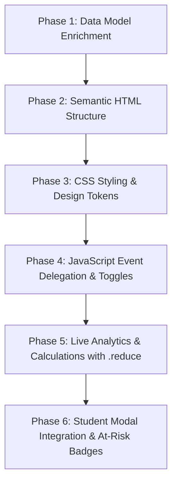

# 📋 EduManage — Attendance Management Plan
## Roll Call & Live Analytics Module Architecture

Welcome to the **Attendance System Architecture & Implementation Plan** for the **EduManage School Management System**. This document outlines the technical design, data model, user experience flow, step-by-step implementation milestones, and core JavaScript learning objectives before writing any production code.

---

## 📌 1. Executive Summary & Goals

### The Problem
Currently, the EduManage student records contain only a static integer field (`attendance: 96`). There is no mechanism for an administrator or teacher to:
1. View daily attendance by class.
2. Mark students as Present, Late, or Absent.
3. Compute live attendance statistics across classes.
4. Record actual check-in timestamps in school time (`Africa/Accra` GMT).

### The Solution
Implement an **Interactive Daily Roll Call & Live Analytics Dashboard** that:
* Allows filtering by class (**All**, **Form 1**, **Form 2**, **Form 3**).
* Provides 1-click attendance status toggle pills (**Present**, **Late**, **Absent**).
* Offers a bulk **"Mark All Present"** shortcut.
* Dynamically calculates and displays **Live Analytics** (Present count, Late count, Absent count, Attendance Rate %) in real time.
* Integrates directly into the existing **Student Profile Modal** to show individual attendance status badges and historical rates.

---

## 🎯 2. Core User Stories

* **US-1 (Filter by Class)**: As a teacher, I want to filter the roll call sheet by my specific class (*Form 1*, *Form 2*, or *Form 3*) so that I only see students in my classroom.
* **US-2 (1-Click Status Toggles)**: As a teacher, I want to click a single status button (*Present*, *Late*, *Absent*) next to a student to instantly update their status without reloading the page.
* **US-3 (Timestamp Recording)**: As an admin, when a student is marked *Present* or *Late*, I want their check-in time recorded in official school time (`HH:MM:SS GMT`).
* **US-4 (Rapid Roll Call)**: As a teacher in a hurry, I want a "Mark All Present" button that sets all currently visible students to *Present* at once.
* **US-5 (Live Attendance Metrics)**: As an administrator, I want to see real-time counters and an attendance rate percentage that recalculates immediately whenever a status changes.
* **US-6 (At-Risk Attendance Warnings)**: As an administrator, I want students with low overall attendance (< 80%) visually highlighted with an "At Risk" warning badge.
* **US-7 (Modal History)**: As an administrator, when I click on a student's profile, I want to see their today's attendance status and their overall term attendance rate.

---

## 🗄️ 3. Data Model Design

### A. Current Student Object Structure
```javascript
{
  id: 1,
  name: 'Ama Mensah',
  gender: 'Female',
  class: 'Form 1',
  attendance: 96, // Static percentage
  // ... other fields
}
```

### B. Enriched Attendance State Model
To track both **today's daily roll call** and **cumulative historical attendance**, each student record will include a `dailyAttendance` object:

```javascript
{
  id: 1,
  name: 'Ama Mensah',
  class: 'Form 1',
  overallAttendance: 96, // Term percentage (0-100)
  dailyAttendance: {
    date: '2026-09-04',       // Current academic date (YYYY-MM-DD)
    status: 'Present',        // 'Present' | 'Late' | 'Absent' | 'Unmarked'
    timestamp: '08:15:22 GMT',// Check-in time (null if absent/unmarked)
    note: ''                  // Optional note (e.g. 'Excused - Medical')
  }
}
```

### C. Attendance Calculation Formulas
1. **Daily Attendance Rate (% for class or school)**:
   $$\text{Daily Attendance Rate} = \left( \frac{\text{Present Students} + (0.5 \times \text{Late Students})}{\text{Total Enrolled Students}} \right) \times 100$$
   *(Late students count as half-credit attendance or can count as present based on school policy).*

2. **At-Risk Indicator Threshold**:
   * **Good Standing (🟢)**: $\ge 90\%$
   * **Satisfactory (🟡)**: $80\% - 89\%$
   * **At-Risk Warning (🔴)**: $< 80\%$

---

## 🖥️ 4. UI & Layout Architecture

### A. Dashboard Placement
The Attendance section will sit cleanly in `index.html` right below the **Dashboard Stats** and above the **Students Section**:

```
+-------------------------------------------------------------+
|                     HEADER & SCHOOL CLOCK                   |
+-------------------------------------------------------------+
|                     HERO BANNER                             |
+-------------------------------------------------------------+
|                     DASHBOARD STAT CARDS                    |
|  [ Total Students: 15 ] [ Classes: 3 ] [ Term: 1 Sept... ]  |
+-------------------------------------------------------------+
|  >>> NEW: ATTENDANCE & ROLL CALL MODULE <<<                 |
|                                                             |
|  [ Today: Friday, 4 Sept 2026 ] [ 🕒 School Time: 08:30 GMT ] |
|                                                             |
|  +-------------------------------------------------------+  |
|  | LIVE METRICS:                                         |  |
|  | [ Present: 12 ] [ Late: 2 ] [ Absent: 1 ] [ Rate: 93%]|  |
|  +-------------------------------------------------------+  |
|                                                             |
|  Filters: [ All ] [ Form 1 ] [ Form 2 ] [ Form 3 ]          |
|  Actions: [ ⚡ Mark All Visible Present ] [ 🔄 Reset Today ]|
|                                                             |
|  STUDENT ROLL CALL LIST / TABLE:                            |
|  +-------------------------------------------------------+  |
|  | Ama Mensah   (Form 1) | [✅ Pres] [⏰ Late] [❌ Abs] |   |
|  | Henri Miessan(Form 3) | [✅ Pres] [⏰ Late] [❌ Abs] |   |
|  | Daniel Owusu (Form 2) | [✅ Pres] [⏰ Late] [❌ Abs] |   |
|  +-------------------------------------------------------+  |
+-------------------------------------------------------------+
|                     TOP ACHIEVERS (🏆)                      |
+-------------------------------------------------------------+
|                     STUDENT CARDS DIRECTORY                 |
+-------------------------------------------------------------+
|                     CONTACT ADMINISTRATION                  |
+-------------------------------------------------------------+
```

### B. Status Pill Button States
* **Present (✅)**:
  * Default: Neutral outline.
  * Active: Emerald green background (`hsl(150, 70%, 40%)`), white bold text, green glowing shadow.
* **Late (⏰)**:
  * Default: Neutral outline.
  * Active: Warm amber background (`hsl(38, 92%, 50%)`), dark text, amber glowing shadow.
* **Absent (❌)**:
  * Default: Neutral outline.
  * Active: Ruby red background (`hsl(0, 75%, 55%)`), white bold text, red glowing shadow.

---

## 🚀 5. Implementation Roadmap (Phased Approach)

We will execute the implementation in 6 structured phases:



### 📍 Phase 1: Data Architecture & Initialization
* Update `script.js` student data array with initial `dailyAttendance` objects.
* Create helper functions:
  * `getAttendanceStatus(studentId)`
  * `setAttendanceStatus(studentId, status)`
  * `getSchoolTimestamp()` using native `Intl.DateTimeFormat` with `Africa/Accra`.

### 📍 Phase 2: HTML Structure & Accessibility (A11y)
* Add `<section class="attendance-section">` in `index.html`.
* Implement accessible tab buttons (`role="tablist"`, `aria-selected="true/false"`).
* Build an accessible roster table/cards with proper `aria-pressed="true/false"` for toggle pills.
* Include an `aria-live="polite"` container so screen readers announce stat updates.

### 📍 Phase 3: CSS & Visual Polish
* Define new HSL color tokens for attendance statuses (`--status-present`, `--status-late`, `--status-absent`).
* Style the Live Analytics summary bar with glassmorphic cards and subtle gradient borders.
* Style the status toggle button group with micro-animations (`transform: scale(0.97)` on click).
* Ensure responsive styling on mobile screens (stacking buttons or converting to a compact grid).

### 📍 Phase 4: Core JavaScript & Event Delegation
* Implement single event listener on the attendance list container (Event Delegation via `e.target.closest('[data-action]')`).
* Handle status toggling:
  * Update student record in memory.
  * Set timestamp if status is *Present* or *Late*.
  * Update button active classes immediately.
* Implement class filter tabs using `students.filter()`.
* Implement bulk action: "Mark All Visible Present" iterating through filtered students.

### 📍 Phase 5: Live Analytics Engine (`.reduce()` & Formulas)
* Write `calculateAttendanceMetrics(studentList)` using `Array.prototype.reduce()`:
  * Count total present, late, absent, and unmarked.
  * Compute the attendance percentage rounded to 1 decimal place.
* Dynamically update DOM elements:
  * `#metricPresentCount`
  * `#metricLateCount`
  * `#metricAbsentCount`
  * `#metricAttendanceRate`
  * Animated progress bar width (`style.width = `${rate}%``).

### 📍 Phase 6: Student Profile Modal Integration
* Enhance the existing modal renderer (`renderModalDetails`):
  * Display a dedicated **"Today's Attendance"** card with status pill and timestamp.
  * Display the **Overall Attendance Rate** with color-coded warning badge:
    * $\ge 90\%$: `badge-success` ("Excellent")
    * $80-89\%$: `badge-warning` ("Good")
    * $< 80\%$: `badge-danger` ("At Risk")

---

## 🧠 6. Key JavaScript Learning Objectives

This module gives you hands-on practice with essential ES6+ concepts:

| Concept | Where It Is Used in This Feature | Why It Matters |
| :--- | :--- | :--- |
| **Event Delegation** | Handling clicks on dozens of attendance buttons with 1 parent listener | Highly performant; works even when DOM elements are re-rendered |
| **`dataset` Attributes** | `data-id="${student.id}"` and `data-status="present"` on buttons | Clean way to pass data between HTML and JavaScript |
| **`Array.prototype.reduce()`** | Calculating totals for Present, Late, Absent, and overall percentage | The most versatile array aggregator in JavaScript |
| **`Array.prototype.filter()`** | Filtering the roll call list by class (`Form 1`, `Form 2`, `Form 3`) | Core skill for data-driven web applications |
| **`Array.prototype.find()`** | Locating a specific student by ID to update their status | Efficient single-object lookup |
| **`Intl.DateTimeFormat`** | Generating official school timestamps (`HH:MM:SS GMT`) | Professional timezone-safe date management |
| **State Mutation & Sync** | Updating JavaScript object and reflecting it in the DOM | The fundamental pattern behind modern frameworks (React, Vue) |

---

## ♿ 7. Accessibility (A11y) & Edge Cases

1. **Screen Reader Feedback**:
   * Toggle buttons must have descriptive `aria-label`s, e.g., `aria-label="Mark Ama Mensah as Present"`.
   * Current active state indicated via `aria-pressed="true"`.
2. **Keyboard Navigation**:
   * All status pills are native `<button>` elements, ensuring they are reachable via `Tab` and activatable via `Enter` or `Space`.
3. **Empty States**:
   * If a filtered class has no students, render a helpful empty state message instead of a blank screen.
4. **Timezone Uniformity**:
   * All timestamps use `Africa/Accra` (GMT) so check-ins are consistent regardless of the user's local laptop timezone.

---

## 📝 8. Approval & Next Steps

Before writing code, please review this plan. If you are satisfied with this architecture:
1. We will begin with **Phase 1 & Phase 2** (Data model & semantic HTML structure).
2. We will test and verify each phase iteratively.
